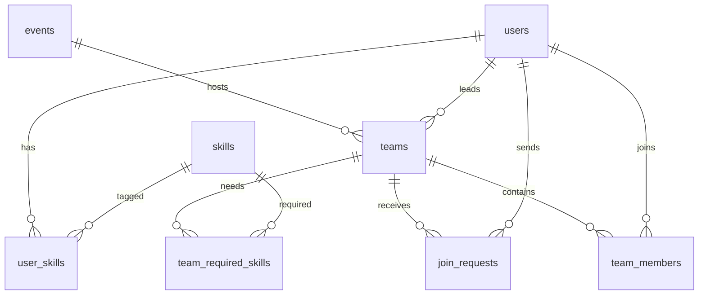

# TeamUp: Hackathon & Project Team Matchmaker (XAMPP + Python edition)

Students find teammates with complementary skills for hackathons.
Stack: **MySQL/MariaDB (XAMPP) + Python Flask**, vanilla JS front end, pure-Python cosine-similarity recommender.

How the pieces fit:
* **XAMPP** provides the database (MySQL/MariaDB) and **phpMyAdmin** to browse/run SQL.
* **Python (Flask)** is the web server and business logic, running on http://localhost:5000.
  (Apache is only needed if you want phpMyAdmin; Flask does not run through Apache.)

## Setup on Windows (about 5 minutes)

1. **Install XAMPP**, open the XAMPP Control Panel and click **Start** next to **MySQL** (and **Apache** if you want phpMyAdmin at http://localhost/phpmyadmin).
2. **Install Python 3.10+** (tick "Add Python to PATH"), then in this folder:
   ```bash
   python -m venv venv
   venv\Scripts\activate            # macOS/Linux: source venv/bin/activate
   pip install -r requirements.txt
   ```
3. **Configure** (optional with stock XAMPP). Copy `.env.example` to `.env`. The defaults already match XAMPP:
   `DB_HOST=127.0.0.1  DB_PORT=3306  DB_USER=root  DB_PASSWORD=(empty)  DB_NAME=teamup`.
   If you set a MySQL root password or XAMPP uses another port, edit it there.
4. **Create the database and fill it with 300 fake students:**
   ```bash
   python seed.py 300
   ```
   This drops/recreates the `teamup` database, runs `schema.sql`, and inserts data.
   Open phpMyAdmin and you will see the `teamup` database with all tables, triggers and the view.
5. **Run the app:**
   ```bash
   python app.py
   ```
   Open http://localhost:5000

Demo login: `demo1@univ.edu` / `password123` (every seeded user has this password).
* `demo1@univ.edu` is Aarav, a backend developer without a team.
* `demo2@univ.edu` is Diya, a designer who leads "Demo Squad" (needs Python, Django, SQL).
Log in as Aarav and request to join, then log in as Diya and accept from My dashboard.

### Alternative: create the schema in phpMyAdmin only
phpMyAdmin > **Import** > choose `schema.sql` > Go. (It creates the `teamup` database with an empty schema; add events and skills yourself, or use `seed.py` for demo data.)

### Troubleshooting
| Message | Fix |
|---|---|
| `Can't connect to MySQL server on '127.0.0.1'` | MySQL is not started in the XAMPP Control Panel, or the port in `.env` is wrong. |
| `Access denied for user 'root'` | You set a root password. Put it in `DB_PASSWORD` in `.env`. |
| `Unknown database 'teamup'` | Run `python seed.py` first. |
| Port 3306 busy | Another MySQL is running. Stop it, or change XAMPP's port and `DB_PORT`. |

## Features
Find teammates (multi-filter search), team search by name, event pages, smart recommendations, requests and invites, leave team, leader can remove members, dashboard, insights, optional email notifications.

## ER diagram


## Where each DBMS concept appears
| Concept | Where |
|---|---|
| Normalisation (3NF), M:N junction tables | `user_skills`, `team_required_skills` |
| Constraints (PK/FK/CHECK/UNIQUE) | `schema.sql`: named constraints, level 1-5, team size, status values (InnoDB enforces FKs; CHECK needs MariaDB 10.2+/MySQL 8.0.16+) |
| One team per event per student | `UNIQUE (event_id, user_id)` on `team_members` |
| "Partial" unique index | MySQL has none, so `join_requests.pending_key` is a **generated column** (1 while pending, else NULL) inside `UNIQUE(team_id,user_id,pending_key)`. NULLs never collide, so only one *pending* request per team/user exists |
| Triggers | `trg_block_full_team` (SIGNAL error 45000), `trg_member_added`, `trg_member_removed` keep `current_size`/`status` correct |
| View | `v_skill_gap` (demand vs supply) |
| Indexes | `idx_user_skills_skill`, `idx_users_filters` |
| Multi-filter JOIN + GROUP BY/HAVING | `/api/users/search`: "has ALL these skills" uses `HAVING COUNT(DISTINCT skill_id) = n` |
| Subqueries / NOT EXISTS | free-agent filter, analytics |
| ACID transaction + row locking | `respond()` in `app.py` |
| Recommendation engine | `recommender.py` |

### The accept-invite transaction
`START TRANSACTION` then `SELECT ... FOR UPDATE` (row-locks the request and its team, so two leaders cannot take the last seat at once):
1. Insert into `team_members`. Triggers reject a full team, then bump `current_size` and set `status='full'`.
2. Mark the request `accepted`.
3. Close all of that student's other pending requests in the same event.
4. If the team is now full, close its remaining pending requests.
Any failure runs `ROLLBACK`, so data is never half-updated. (Tested: two simultaneous accepts for the last seat give one success and one clean "team just filled up" error.)

### Recommendation engine
Every skill is a dimension. User vector = proficiency/5; team vector = skills the team **still needs** (required minus those covered by members at level >= 3). Score = cosine similarity. SQL pre-filters candidates who own at least one needed skill, then Python ranks the top 5. It works both ways: top-5 teammates for a team, top-5 teams for a student.

## What changed from the SQLite version
| SQLite | MySQL / MariaDB |
|---|---|
| `AUTOINCREMENT`, `TEXT` keys | `AUTO_INCREMENT`, `VARCHAR` (needed for UNIQUE/indexes) |
| Inline `REFERENCES` | Explicit `FOREIGN KEY` clauses (MySQL ignores inline ones) |
| Partial unique index | Generated column + unique index (see above) |
| `RAISE(ABORT, ...)` triggers | `SIGNAL SQLSTATE '45000'` triggers (`DELIMITER $$` blocks) |
| `BEGIN IMMEDIATE` | `START TRANSACTION` + `SELECT ... FOR UPDATE` |
| `?` / `:name` placeholders | `%s` / `%(name)s` (PyMySQL) |
| `INSERT OR REPLACE / IGNORE` | `ON DUPLICATE KEY UPDATE` / `INSERT IGNORE` |
| `ORDER BY rowid` | `ORDER BY joined_at, user_id` |
| `sqlite3.IntegrityError` text matching | MySQL error numbers (1062 duplicate, 1644 trigger SIGNAL) |

Gotcha worth knowing for your viva: MySQL evaluates `SET a=..., b=...` left to right, so in `trg_member_added` the `status` assignment must come *before* `current_size = current_size + 1`, otherwise it reads the already-incremented value.

## Email notifications (optional)
When a student requests to join, the team leader is emailed; when a leader invites a student, the student is emailed.
1. In `.env` set `SMTP_USER` and `SMTP_PASSWORD` (a Gmail **app password**: Google Account > Security > 2-Step Verification > App passwords).
2. Restart `python app.py`; check the terminal for `[mail] sent to ...`.
3. Seeded `@univ.edu` addresses are fake and skipped. Set `MAIL_REDIRECT_TO=you@gmail.com` to route all mail to your inbox for testing.
Never commit or share `.env`.

## Deploy for real students
```bash
export SECRET_KEY="long-random-string"
gunicorn -w 4 -b 0.0.0.0:$PORT app:app      # with a hosted MySQL; set DB_* variables
```
Do not run `seed.py` against real data (it drops the database). Restrict sign-up to your university email domain (one `if` in `/api/register`), serve over HTTPS, and add an admin to create events.
